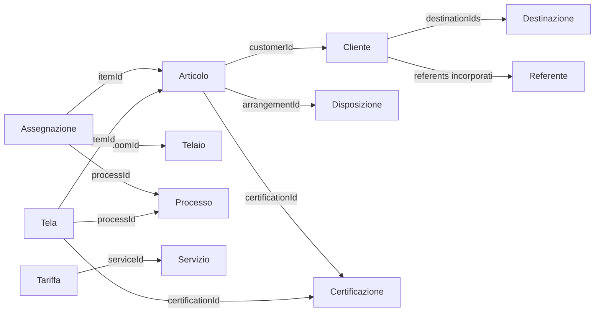

# WeavOps

WeavOps è un gestionale per aziende tessili che semplifica la gestione aziendale e il monitoraggio del processo di produzione di una tela.

Il progetto è composto da:

- **Frontend**: interfaccia web.
- **Backend**: API e logica applicativa.

## Architettura

WeavOps è composto da un frontend web Angular e da un backend Java basato su Spring Boot. Il backend espone le API applicative e usa MongoDB per la persistenza dei dati.

```text
Utente
  │
  ▼
Frontend Angular (porta 4200)
  │ richieste API (/api)
  ▼
Backend Spring Boot (porta 8080)
  │
  ▼
MongoDB
```

In ambiente di sviluppo, il proxy del frontend inoltra le richieste `/api` al backend. La documentazione delle API è disponibile tramite Swagger UI all'indirizzo `http://localhost:8080/swagger-ui.html`.

## Funzionalità

- Monitora lo stato operativo dei telai registrati.
- Tiene traccia delle pezze prodotte ogni giorno.
- Gestisce le scadenze di produzione e consegna.
- Stima la data di completamento di un articolo quando viene avviato in produzione.
- Suggerisce quanti telai assegnare per completare la produzione entro la data di consegna.
- Esporta in PDF la disposizione delle lavorazioni per ciascun telaio.
- Esporta in PDF lo storico delle operazioni eseguite su un telaio.
- Esporta in PDF i dati riepilogativi della produzione al suo completamento.

## Entità e relazioni

Le entità persistite sono definite in [`be/src/main/java/org/openapitools/domain`](be/src/main/java/org/openapitools/domain). I modelli in `org.openapitools.model` descrivono invece i dati scambiati dalle API: un attributo presente nella risposta API non è necessariamente un campo salvato nel database.

### Anagrafiche

- **Cliente (`CustomerEntity`)**: azienda committente, con partita IVA, indirizzo e contatti. Un cliente può avere più articoli e più referenti.
- **Referente (`ReferentEntity`)**: persona di contatto, con nome, cognome, telefono ed email. I referenti vengono salvati nella propria collezione e incorporati anche nel documento del cliente.
- **Destinazione (`DestinationEntity`)**: azienda e indirizzo italiano di destinazione. La relazione cliente–destinazione è molti-a-molti: `customers.destinationIds` contiene gli ID delle destinazioni, che possono essere condivise da clienti diversi.
- **Certificazione (`CertificationEntity`)**: sigla e descrizione della certificazione, per esempio GRS e GOTS. Articoli e Tele fanno riferimento a questa anagrafica tramite `certificationId`.

### Articoli e produzione

- **Articolo (`ItemEntity`)**: commessa produttiva collegata al cliente tramite `customerId` e alla disposizione tramite `arrangementId`. Contiene lo stato, l'avanzamento, i pesi dell'intero articolo e l'indicazione delle pezze certificate.
- **Disposizione (`ArrangementEntity`)**: dati tecnici e quantità previste dell'articolo: pettine, ordito, numero e lunghezza delle pezze, colpi per decimetro e data di consegna.
- **Telaio (`LoomEntity`)**: macchina identificata da `serialNumber`, con stato operativo e indicazione dell'assegnazione.
- **Processo (`ProcessEntity`)**: lavorazione con velocità, resa, quantità previste e prodotte, date e numero Tela prenotato. `fabricCode` viene inserito alla creazione del processo. Il processo contiene anche un oggetto `loom` incorporato.
- **Assegnazione (`LoomItemAssignmentEntity`)**: collega un articolo, un telaio e un processo tramite `itemId`, `loomId` e `processId`. Gestisce lo stato della produzione assegnata, inclusa la coda. Un articolo può essere lavorato da più processi e telai; un telaio può avere più assegnazioni nel tempo.
- **Tela (`FabricEntity`)**: risultato di un processo terminato con pezze prodotte. Un processo può generare al massimo una Tela, anche quando viene abbandonato dopo avere prodotto pezze. Ogni Tela contiene più pezze e ha una sola eventuale certificazione. `code` identifica la Tela; `itemId` e `processId` identificano articolo e processo di origine.



Il diagramma mostra i collegamenti logici gestiti dall'applicazione. MongoDB non applica automaticamente vincoli di chiave esterna. Sono inoltre presenti copie incorporate: `customers.items`, `customers.referents`, `items.processing` e `processes.loom`. Non sono `DBRef` e non vengono sincronizzate automaticamente da MongoDB.

La certificazione dell'articolo usa `isCertified`: `ALL` significa tutte le pezze certificate, `NONE` nessuna e `PARTIAL` alcune. Per una Tela, `ALL` usa la certificazione dell'articolo, `NONE` non assegna certificazioni e `PARTIAL` consente di scegliere l'eventuale certificazione alla chiusura del processo. `fabrics.certificationValue` conserva anche una copia della sigla.

I valori derivati sono:

- Peso totale articolo, in kg: `warpWeight + weftWeight`.
- Peso per pezza della Tela, in kg: peso totale articolo / `arrangements.piecesCount`.
- Metri totali della Tela: `fabrics.piecesCount × fabrics.metersPerPiece`.
- Kg totali della Tela: `fabrics.piecesCount × fabrics.weightPerPiece`.

La Tela salva numero di pezze, metri per pezza e peso per pezza al momento della produzione. I suoi totali vengono calcolati nelle risposte API; non sono campi separati di `FabricEntity`.

### Servizi e tariffe

**Servizio (`ServiceEntity`)** identifica una lavorazione. Ogni servizio può avere più **tariffe (`RateEntity`)**, collegate tramite `serviceId`:

| Codice servizio | Lavorazione | Criterio |
|---|---|---|
| `PICKS` | Colpi | Fasce di colpi per decimetro |
| `KNOTTING` | Annodature | Fasce del numero di fili |
| `DRAWING_IN` | Licciate | Fasce del numero di fili |
| `SAMPLE_LOOMS` | Telai a campione | Numero esatto di ore |

Per colpi, annodature e licciate, `minimum` è incluso e `maximum` escluso; `maximum: null` indica una fascia senza limite superiore. Le fasce dello stesso servizio non possono sovrapporsi. Per i telai a campione si usa invece `hours`, positivo e anche decimale: non si compilano minimo e massimo e non sono consentite due tariffe della stessa durata.

`pricingType` distingue:

- `FIXED`: importo fisso della lavorazione, con al massimo due decimali.
- `PER_THREAD`: importo per filo, con al massimo sei decimali, moltiplicato per **tutti** i fili; disponibile per i servizi basati sui fili.
- `ON_REQUEST`: tariffa da concordare; `amount` è nullo e `description` contiene il testo da mostrare nel listino. Serve concordare l'importo prima della fatturazione.

Gli importi sono in euro, IVA esclusa. Il listino iniziale prevede licciate fino a 3.000 fili a 140 euro, oltre 3.000 fili a 0,045 euro per ogni filo totale; un telaio a campione per 24 ore costa 140 euro. `RatePriceCalculator` calcola il prezzo della tariffa già selezionata, arrotondando il totale a due decimali. Le tariffe esistenti senza `pricingType` vengono interpretate come `FIXED`.

### Storici, calendario e utenti

- `CustomerItemHistoryEntity` collega cliente e articolo per la consultazione dello storico.
- `LoomProcessHistoryEntity` collega telaio e processo per lo storico delle lavorazioni.
- `LoomLogEntity` registra eventi operativi, data e quantità aggiunte, conservando anche codice telaio, nome articolo e stato come dati dell'evento.
- `CalendarEventEntity` può fare riferimento ad assegnazione, telaio, processo, articolo e disposizione. La categoria è identificata da `categoryId` e descritta da `CalendarEventCategoryEntity`.
- `ProductionSummaryPdfEntity` conserva un PDF riepilogativo e il riferimento al telaio.
- `UserEntity` rappresenta gli utenti autenticati. Non contiene un collegamento obbligatorio alle commesse o ai clienti.

## Collezioni MongoDB e attributi

Una **collezione** è un insieme di documenti MongoDB, generalmente dedicato a un tipo di entità. Ogni documento contiene campi e valori; può incorporare altri oggetti o liste. Il nome effettivo della collezione è quello specificato dall'annotazione `@Document(collection = "...")`.

In tutte le entità seguenti, `id` è l'identificativo esposto dal backend e viene mappato al campo MongoDB `_id`. I campi `...Id` sono riferimenti logici ad altri documenti. Le date Java `Instant` rappresentano istanti UTC. Gli importi e i confini delle tariffe sono `BigDecimal`, persistiti come BSON `Decimal128` nella collezione `rates`.

### Anagrafiche

| Collezione | Entità | Attributi e significato |
|---|---|---|
| `customers` | `CustomerEntity` | `id`; `name` (ragione sociale); `email`; `vatNumber` (partita IVA alfanumerica); `note`; `street`, `streetNumber`, `postalCode`, `city`, `provinceCode` (indirizzo italiano); `destinationIds` (lista di ID di destinazioni); `referents` (lista di referenti incorporati); `items` (lista di articoli incorporati). |
| `destinations` | `DestinationEntity` | `id`; `name` (nome azienda); `street` (via/piazza), `streetNumber` (civico), `postalCode` (CAP), `city` (comune), `provinceCode` (sigla provincia). |
| `referents` | `ReferentEntity` | `id`; `firstName`, `lastName` (nome e cognome); `phoneNumber`; `email`. |
| `certifications` | `CertificationEntity` | `id`; `value` (sigla, per esempio GRS); `description` (descrizione della certificazione). |

### Produzione

| Collezione | Entità | Attributi e significato |
|---|---|---|
| `arrangements` | `ArrangementEntity` | `id`; `itemName`; `reedCount`, `reedCM` (misura pettine); `reedHight` (altezza pettine, m); `warpLenght` (lunghezza ordito, m); `piecesCount` (pezze previste); `pieceLenght` (metri per pezza); `warpEndCount` (numero fili ordito); `hitsPerDm` (colpi per decimetro); `deliveryDate`; `worksSaturday`, `saturdayStartTime`, `saturdayEndTime`, `worksSunday`, `sundayStartTime`, `sundayEndTime` (lavorazione nel fine settimana). |
| `items` | `ItemEntity` | `id`; `arrangementId`; `customerId`; `state`; `totalMeters`, `metersRun` (metri previsti e prodotti); `processing` (lista di processi incorporati); `startDate`, `endDate`, `expectedEndDate`; `isArchived`, `isDelivered`, `isLate`; `warpWeight`, `weftWeight` (kg dell'intero articolo); `isCertified` (`ALL`, `NONE`, `PARTIAL`); `certificationId`. |
| `looms` | `LoomEntity` | `id`; `serialNumber` (numero/codice telaio); `status`; `isAssigned` (indicazione dell'assegnazione). |
| `processes` | `ProcessEntity` | `id`; `speed` (colpi/minuto); `efficiency` (resa percentuale); `totalMeters`, `metersRun`, `metersToGo`; `startDate`, `endDate`, `expectedEndDate`; `days` (giorni stimati); `loom` (oggetto telaio incorporato); `itemHitsPerDm`; `totalPieces`, `piecesRun`; `metersPerPiece`; `grs`, `gots` (indicatori di certificazione già presenti nel modello del processo); `notes`; `fabricCode` (numero Tela prenotato). |
| `loom_item_assignments` | `LoomItemAssignmentEntity` | `id`; `loomId`; `itemId`; `processId`; `status` (stato dell'assegnazione). |
| `fabrics` | `FabricEntity` | `id`; `code` (codice Tela); `itemId`; `processId`; `certificationId`; `certificationValue` (sigla copiata); `piecesCount` (pezze prodotte); `metersPerPiece`; `weightPerPiece` (kg per pezza); `producedAt`; `status`. |

I nomi `reedHight`, `warpLenght` e `pieceLenght` sono quelli effettivamente presenti nelle entità persistite; nelle API corrispondono rispettivamente a `reedHeight`, `warpLength` e `pieceLength`. Non rinominare soltanto uno dei due livelli senza verificare mapper e dati esistenti.

`items.totalWeight` e `fabrics.totalMeters`/`totalWeight` sono valori calcolati, non campi persistiti delle rispettive entità. `LoomItemAssignmentEntity.fabricCode` e `fabricCertificationId` sono annotati `@Transient`: servono al flusso di chiusura ma non vengono salvati in `loom_item_assignments`.

Il codice della Tela e il riferimento `fabrics.processId` hanno indici univoci. Anche `processes.fabricCode` ha un indice univoco `sparse`, che permette ai processi privi del numero Tela di restare compatibili. Gli indici vengono gestiti dagli inizializzatori e dalle annotazioni delle entità.

### Listino

| Collezione | Entità | Attributi e significato |
|---|---|---|
| `services` | `ServiceEntity` | `id`; `code` (`PICKS`, `KNOTTING`, `DRAWING_IN`, `SAMPLE_LOOMS`); `name`; `bandCriterion` (`PICKS_PER_DM`, `THREADS`, `HOURS`). |
| `rates` | `RateEntity` | `id`; `serviceId`; `minimum`, `maximum` (fasce per colpi/fili); `hours` (durata esatta per telai a campione); `amount` (importo numerico o nullo per `ON_REQUEST`); `pricingType` (`FIXED`, `PER_THREAD`, `ON_REQUEST`); `description` (testo facoltativo, obbligatorio per `ON_REQUEST`). |

`ServiceDatabaseInitializer` crea le collezioni assenti e inserisce i servizi mancanti. `initializeRates()` inserisce il listino iniziale **soltanto se `rates` è vuota**. Modificare il codice di inizializzazione non aggiorna automaticamente le tariffe già presenti. Per aggiungere una durata di un telaio a campione si usa, per esempio, `seedHourlyRate("24", "140.00")`.

### Storici e documenti

| Collezione | Entità | Attributi e significato |
|---|---|---|
| `customer-item-history` | `CustomerItemHistoryEntity` | `id`; `customerId`; `itemId`. Collega cliente e articolo nello storico. |
| `loom-process-history` | `LoomProcessHistoryEntity` | `id`; `loomId`; `processId`. Collega telaio e processo nello storico. |
| `loom-log` | `LoomLogEntity` | `id`; `key` (tipo/chiave dell'evento); `loomId`, `loomCode`, `loomStatus`; `itemId`, `itemName`; `metersAdded`; `createdAt`. |
| `production-summary-pdfs` | `ProductionSummaryPdfEntity` | `id`; `loomId`; `loomNumber`; `fileName`; `content` (contenuto binario del PDF); `createdAt`. |

### Calendario

| Collezione | Entità | Attributi e significato |
|---|---|---|
| `calendar-event-category` | `CalendarEventCategoryEntity` | `id`; `name`; `color`; `standard` (categoria standard). |
| `calendar-event` | `CalendarEventEntity` | `id`; `description`; `date`; `type`; `assignmentId`, `loomId`, `processId`, `itemId`, `arrangementId` (riferimenti opzionali secondo l'evento); `categoryId`. |

### Autenticazione e dati tecnici

| Collezione | Entità/componente | Attributi e significato |
|---|---|---|
| `users` | `UserEntity` | `id`; `username` (univoco); `password` (hash BCrypt); `credentialVersion` (versione delle credenziali per invalidare i JWT precedenti); `firstName`; `lastName`; `email`. |
| `weavops_provisioning` | `AdminProvisioningService` | Collezione tecnica senza una classe `@Document`: il documento `_id: "first-admin"` contiene `generation`, contatore usato per coordinare la creazione del primo utente nella transazione. |

Le notifiche e i suggerimenti di produzione sono calcolati dal backend e non hanno una propria entità `@Document`. Le voci di menu Audit, Bolle e Fatture non implicano da sole l'esistenza di collezioni: l'elenco qui documentato descrive la persistenza implementata attualmente.


## Avvio rapido

### Prerequisiti

- Node.js e npm
- Java 17
- Maven
- MongoDB configurato con il replica set `replicaset-01`

### Avvio del backend

Avvia MongoDB e poi, dalla cartella `be`, esegui:

```bash
mvn spring-boot:run
```

Il backend sarà disponibile su `http://localhost:8080`. La documentazione API è disponibile su `http://localhost:8080/swagger-ui.html`.

### Avvio del frontend

Da un altro terminale, dalla cartella `fe`, installa le dipendenze e avvia il server di sviluppo:

```bash
npm ci
npm start
```

Apri `http://localhost:4200` nel browser. In sviluppo, il proxy del frontend inoltra le richieste API al backend sulla porta `8080`.

## Configurazione

### MongoDB

Il backend si connette al database `weavops` su `127.0.0.1:27017` e richiede un replica set chiamato `replicaset-01`. Per un ambiente locale a nodo singolo, crea prima la cartella dati (se non esiste) e avvia MongoDB da PowerShell:

```powershell
New-Item -ItemType Directory -Force C:\data\weavops
mongod --dbpath C:\data\weavops --replSet replicaset-01 --bind_ip localhost --port 27017
```

Lascia aperto questo terminale. Al primo avvio, apri un secondo terminale PowerShell e inizializza il replica set:

```powershell
mongosh --host 127.0.0.1:27017
```

Nel prompt di `mongosh`, esegui:

```javascript
rs.initiate({ _id: "replicaset-01", members: [{ _id: 0, host: "127.0.0.1:27017" }] })
rs.status()
```

Attendi che lo stato del nodo diventi `PRIMARY`, poi avvia il backend. L'inizializzazione con `rs.initiate()` va eseguita solo la prima volta per quella cartella dati; agli avvii successivi basta riavviare `mongod` con gli stessi parametri.

La configurazione del backend si trova in `be/src/main/resources/application.properties`. Se usi un'istanza MongoDB diversa, aggiorna `spring.data.mongodb.uri` nel file delle proprietà e assicurati che il replica set sia coerente con l'URI.

### Backend

Il backend legge la configurazione da `be/src/main/resources/application.properties`.

### Frontend

Il frontend usa `/api` come indirizzo base per le richieste API. In sviluppo, `fe/src/proxy.conf.json` inoltra queste richieste a `http://localhost:8080`.

### Sicurezza

La configurazione locale contiene un JWT secret di sviluppo. Prima di usare il progetto in un ambiente condiviso o di produzione, sostituiscilo con un valore sicuro e gestiscilo fuori dal repository. Non inserire credenziali o altri segreti nei file versionati.


